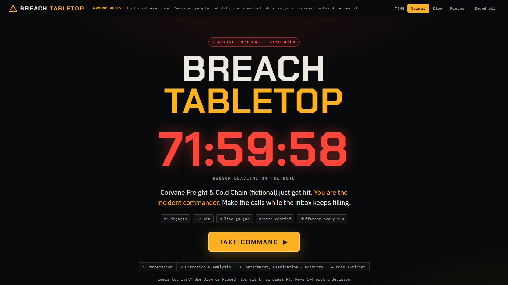
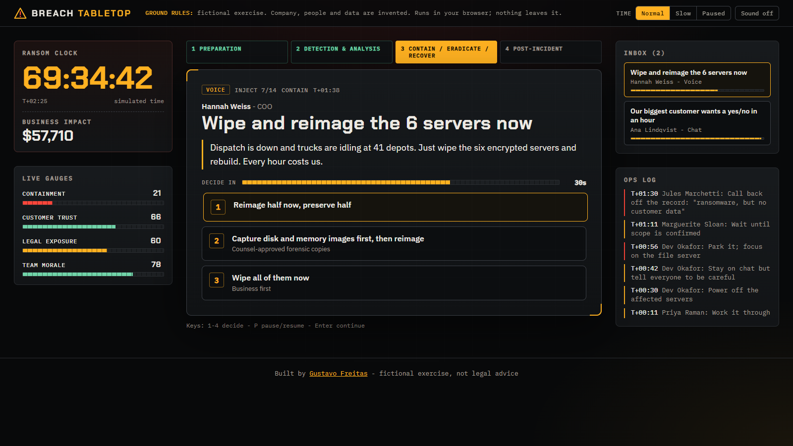

# BREACH TABLETOP

Ransom note on the screen, 72 hours on the clock. You are the incident commander. Make the calls, then get graded against the better move.

**[Live demo](https://tootenramen.github.io/Breach-Tabletop/)**

## What you can do

- Command a ransomware-style intrusion at a fictional freight company through 14 timed injects: SOC pings, a demanding CEO, a reporter, counsel asking about notification clocks, a CFO who wants to just pay, a vendor whose access was abused, backup triage and more.
- Watch four live gauges (Containment, Customer trust, Legal exposure, Team morale) plus a ransom clock and business-impact meter react to every choice.
- Handle messages that arrive while you are still deciding the last one. Slow or freeze the timers any time (accessibility toggle, or press P).
- Finish with a scored debrief: grade, NIST lifecycle phase breakdown, a timeline of your call vs the better move with a one-line why, your 3 best calls and the 1 thing to fix.
- Download a shareable result card as a PNG, then replay: the seed changes the injects, their order, wording and option order.

## How it works

Pure HTML, CSS and JavaScript in a single file. A seeded random generator builds each run from a pool of 19 injects following the NIST incident response lifecycle (preparation, detection and analysis, containment/eradication/recovery, post-incident). Each decision carries a quality rating and gauge effects. The result card is drawn on a canvas. Sound is optional WebAudio synthesis, off by default. 100% client-side: no network calls, no analytics, nothing leaves your browser. Fictional exercise, not legal advice.

**Skills this shows:** incident response and command, decision-making under time pressure, security communications and legal coordination, accessible front-end design, canvas and game-loop engineering.

Built by Gustavo Freitas - [LinkedIn](https://www.linkedin.com/in/gustavo-freitas-69b93910b/) - [more projects](https://github.com/Tootenramen)
